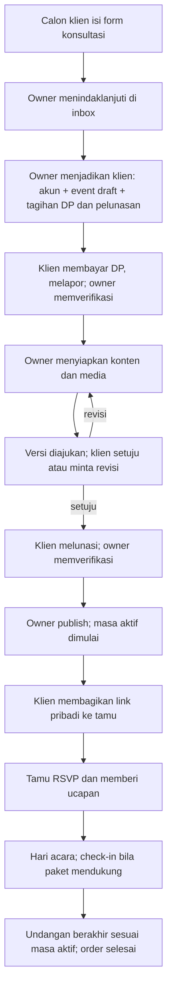

# PRD Occasio: layanan undangan digital per acara

| Info | Isi |
| --- | --- |
| Versi | 1.0 (draft), 27 November 2026 |
| Pemilik produk | Owner Occasio |
| Status | Menunggu persetujuan pemilik. Setelah disetujui, PRD ini menjadi acuan fitur dan prioritas. |
| Dokumen terkait | Model bisnis: [business-model-occasio.md](business-model-occasio.md). Roadmap dan log keputusan: [roadmap-dan-keputusan.md](roadmap-dan-keputusan.md). Spesifikasi celah P1: [spek-teknis-p1.md](spek-teknis-p1.md). SOP: [SOP-operasional.md](SOP-operasional.md). Uji dan checklist rilis: [rencana-uji.md](rencana-uji.md). Status teknis: [core.md](core.md), [BACKEND.md](BACKEND.md). Server, GitHub Pages, dan rilis: [DEPLOY.md](DEPLOY.md). |
| Aturan pakai | Bila PRD bertentangan dengan keputusan aktif di `core.md`, keputusan aktif yang berlaku sampai PRD diperbarui. Status fitur di bagian 7 diambil dari kode per 27 November 2026. |

## 1. Ringkasan arah

**Apa yang dibangun.** Occasio menjual layanan undangan pernikahan digital per acara. Pasangan membayar satu paket, tim Occasio menyiapkan undangan, pasangan menyetujui isinya, lalu undangan dipublikasikan dan tamu mengonfirmasi kehadiran lewat link pribadi. Aplikasi adalah alat kerja untuk menjalankan pesanan itu dari konsultasi sampai hari acara, bukan produk SaaS swalayan.

**Ke mana arahnya, berurutan:**

1. **Sekarang sampai pilot:** satu paket (Basic) berjalan penuh dengan klien nyata, satu order dari awal sampai akhir, di server online.
2. **Setelah pilot lulus:** buka Premium (QR check-in dan pengelolaan tamu yang lebih intensif) setelah check-in teruji di beberapa perangkat.
3. **Setelah biaya venue terhitung:** buka Signature (pendampingan hari acara dengan perangkat dan petugas).
4. **Baru dipertimbangkan setelah layanan terbukti:** otomasi pesan, add-on visual (live gallery, photo booth), dan white-label untuk vendor lain.

**Satu kalimat arah:** jadikan satu order Basic berjalan rapi dan menguntungkan berulang kali sebelum menambah paket, fitur, atau kanal baru.

## 2. Masalah yang diselesaikan

| Untuk siapa | Masalah | Cara Occasio menjawab |
| --- | --- | --- |
| Pasangan | Mengurus undangan, daftar tamu, dan konfirmasi kehadiran tersebar di chat, spreadsheet, dan pesan pribadi | Satu workspace: isi data, kelola tamu, lihat RSVP, setujui undangan, bayar tagihan |
| Pasangan | Tidak tahu berapa tamu yang benar-benar datang | RSVP lewat link pribadi dengan batas jumlah orang per undangan |
| Tamu | Undangan sulit dibuka, info tersebar, RSVP ribet | Satu halaman undangan per tamu: nama tampil, info acara, RSVP sekali klik, ucapan |
| Owner | Order diproses lewat chat tanpa jejak; pembayaran, revisi, dan publikasi tercampur | Status order, tagihan, versi konten, dan gerbang publish yang tercatat di server |

## 3. Tujuan dan ukuran keberhasilan

### Tujuan bisnis untuk rilis pertama

1. Menjalankan **satu order Basic berbayar** dari konsultasi sampai selesai tanpa langkah di luar aplikasi selain transfer bank dan kirim pesan WhatsApp.
2. Mengetahui **biaya nyata per order** (jam kerja owner, revisi, infrastruktur) untuk menetapkan harga jual final.
3. Mendapatkan **testimoni dan portofolio** dengan izin klien.

### Metrik

Target angka ditetapkan setelah pilot memberi baseline. Yang sudah pasti adalah apa yang diukur.

| Area | Metrik | Cara mengukur |
| --- | --- | --- |
| Penjualan | Lead per bulan dan sumbernya; konversi lead ke DP | Inbox konsultasi dan tagihan DP lunas |
| Kecepatan | Waktu dari DP lunas sampai publish; jumlah putaran revisi | Riwayat audit dan versi konten |
| Keuangan | Kontribusi per order (harga dikurangi biaya langsung) | Catatan jam kerja dan biaya per order |
| Kualitas | Persentase undangan dipublikasikan sebelum tanggal target; insiden hari acara | Audit dan catatan owner |
| Tamu | Persentase tamu yang RSVP dari total undangan | Ringkasan RSVP per event |

**Metrik utama (north star):** jumlah undangan yang dipublikasikan tepat waktu dan lunas per bulan.

### Gerbang kualitas yang wajib sebelum data klien nyata

Diambil dari `core.md` dan sudah diuji di lokal, kecuali yang ditandai.

- Klien A tidak bisa membuka data privat klien B. *(lulus, uji API)*
- Draft dan undangan kedaluwarsa tidak terbuka untuk publik. *(lulus)*
- Gagal simpan tidak menampilkan sukses palsu. *(lulus pada halaman yang diaudit)*
- Publish memerlukan versi disetujui dan pelunasan. *(lulus)*
- RSVP yang dikirim ulang tidak menggandakan hitungan dan tidak melebihi jatah. *(lulus)*
- Cadangan database dan media dapat dipulihkan. *(lulus di lokal; belum di server)*
- Media dan konten tampil sama di beberapa perangkat. *(belum: HP fisik dan dua perangkat belum diuji)*
- Owner dapat menjalankan satu order memakai SOP. *(belum: menunggu pilot)*

## 4. Pengguna

| Peran | Kebutuhan utama | Akses di aplikasi |
| --- | --- | --- |
| Calon klien | Melihat paket dan template, bertanya, menerima penawaran | Website publik dan form konsultasi; belum punya akun |
| Klien (pasangan) | Mengisi data, mengelola tamu, menyetujui undangan, membayar | Dashboard klien untuk event miliknya saja |
| Tamu | Membuka undangan, RSVP, memberi ucapan | Halaman undangan lewat link pribadi; tidak melihat daftar tamu |
| Owner | Mengelola lead, order, tagihan, konten, publikasi, katalog, akun | Semua data dan pengaturan |
| Tim produksi *(nanti)* | Mengerjakan konten event yang ditugaskan | Belum ada; saat ini owner mengerjakan sendiri |
| Petugas check-in *(nanti, Premium)* | Mencatat kedatangan tamu di venue | Belum ada peran khusus; check-in saat ini hanya owner |

## 5. Lingkup rilis

### Rilis 1: pilot Basic (target sekarang)

**Termasuk:**

- Website publik dengan paket, template, FAQ, dan form konsultasi yang masuk ke inbox owner.
- Konversi lead menjadi akun klien dan event draft.
- Tagihan DP 50% dan pelunasan, laporan bayar dari klien, verifikasi manual oleh owner.
- Produksi konten oleh owner, unggah foto/video/musik, empat tema yang sudah diuji.
- Versi konten dan persetujuan klien atas versi tertentu.
- Publish dengan gerbang (disetujui + lunas), masa aktif otomatis dari paket, halaman "Undangan Berakhir".
- Tamu: tambah, impor Excel, ekspor CSV, link pribadi, RSVP dengan jumlah orang, ucapan, bagikan manual ke WhatsApp.
- Chat per event antara owner dan klien.
- Dashboard owner dari data nyata, riwayat audit, backup dan pemulihan.
- Owner dapat menonaktifkan dan menghapus akun klien.

**Tidak termasuk di rilis 1:** payment gateway, pengiriman WhatsApp otomatis, notifikasi email, QR check-in untuk Basic, peran tim produksi dan petugas, domain khusus per pasangan, live gallery, photo booth, desain dari nol, aplikasi HP.

### Rilis 2: Premium

QR check-in dan layar check-in untuk petugas, kuota tamu 500, peran petugas check-in yang hanya melihat event yang ditugaskan, laporan kehadiran untuk klien. Syarat buka: check-in lolos uji di beberapa perangkat dan koneksi lemah.

### Rilis 3: Signature

Pendampingan hari acara (usulan 1 tablet, 1 petugas, maksimal 4 jam), penyesuaian visual terbatas. Syarat buka: biaya kru, perangkat, transportasi, dan wilayah layanan disahkan (keputusan D02), plus simulasi venue lolos.

### Nanti, berdasarkan bukti kebutuhan

Payment gateway, notifikasi WhatsApp/email, live gallery, photo booth, slideshow, domain khusus, white-label untuk vendor.

### Sementara: etalase di GitHub Pages (K9)

Sampai server dibeli, hanya website publik yang tayang (GitHub Pages, mode etalase). Pengunjung bisa melihat paket dan galeri template serta menghubungi lewat WhatsApp. Dashboard, undangan, RSVP, dan form ke inbox owner belum tersedia untuk publik karena butuh server. Rincian batas teknis: `DEPLOY.md` §0.

## 6. Alur utama

### Status yang dipakai aplikasi

Tahap order dihitung otomatis dari tagihan, versi, dan publikasi (`stageOf` di `lib/backend/business.mjs`):

Belum ada tagihan → Menunggu DP → Verifikasi DP → Produksi konten → Menunggu persetujuan klien → Perlu revisi → Menunggu pelunasan → Siap publish → Aktif → Selesai.

Status lain yang terpisah dan tidak boleh dicampur: status lead (Baru, Dihubungi, Menjadi Klien, Batal), status tagihan (belum bayar, bukti dilaporkan, lunas, dibatalkan), keputusan versi (menunggu, disetujui, minta revisi, digantikan), dan publikasi (draft, published, kedaluwarsa).

## 7. Kebutuhan fungsional

Prioritas: **W** = wajib untuk rilis 1, **S** = sebaiknya ada di rilis 1, **N** = rilis berikutnya. Status per 27 November 2026: **Ada**, **Sebagian**, **Belum**.

### 7.1 Website publik dan konsultasi

| ID | Kebutuhan | Prioritas | Status |
| --- | --- | --- | --- |
| F-01 | Website menampilkan paket, template aktif, FAQ, testimoni, dan nomor WhatsApp dari pengaturan owner | W | Ada |
| F-02 | Form konsultasi (nama, WhatsApp, tanggal, paket, budget, catatan) tersimpan ke inbox owner, dengan perlindungan bot dan batas kiriman | W | Ada |
| F-03 | Harga publik bisa disembunyikan atau ditampilkan oleh owner | W | Ada |
| F-04 | Chat privat dengan calon klien sebelum punya akun | N | Belum; kanal sementara: form + WhatsApp |
| F-05 | Penawaran tertulis (scope, harga, jadwal, masa berlaku) yang dikirim ke calon klien | S | Belum; saat ini lewat chat/WhatsApp |

### 7.2 Akun dan akses

| ID | Kebutuhan | Prioritas | Status |
| --- | --- | --- | --- |
| F-10 | Login owner dan klien dengan password yang diverifikasi server, sesi 8 jam, batas percobaan login | W | Ada |
| F-11 | "Jadikan klien" membuat akun klien dan event draft dalam satu langkah | W | Ada |
| F-12 | Klien menetapkan password sendiri lewat link undangan akun (bukan password sementara yang dikirim owner) | S | Belum; saat ini password sementara tampil sekali ke owner |
| F-13 | Owner reset password, ganti password sendiri | W | Ada |
| F-14 | Owner menonaktifkan, mengaktifkan, dan menghapus akun klien | W | Ada |
| F-15 | Peran tim produksi dan petugas check-in dengan akses terbatas | N | Belum |

### 7.3 Order dan pembayaran

| ID | Kebutuhan | Prioritas | Status |
| --- | --- | --- | --- |
| F-20 | Order dan tagihan DP 50% + pelunasan dibuat otomatis dengan salinan harga paket saat itu | W | Ada |
| F-21 | Klien melaporkan pembayaran; status lunas hanya dari verifikasi owner | W | Ada |
| F-22 | Owner menambah tagihan tambahan, membatalkan, dan membuka kembali tagihan | W | Ada |
| F-23 | Klien mengunggah foto bukti transfer | S | Sebagian; saat ini hanya keterangan teks |
| F-24 | Kebijakan pembatalan, refund, dan pindah jadwal tercantum dan disetujui klien | W | Belum (keputusan D05 terbuka) |
| F-25 | Payment gateway | N | Belum |

### 7.4 Produksi konten dan media

| ID | Kebutuhan | Prioritas | Status |
| --- | --- | --- | --- |
| F-30 | Owner mengedit semua isi undangan: mempelai, acara, love story, rekening hadiah, musik | W | Ada |
| F-31 | Unggah foto, video, musik ke server; urutkan dan hapus; jenis file diperiksa dari isinya | W | Ada |
| F-32 | Kuota galeri per paket (Basic 10 foto, Premium 30, Signature 50) ditegakkan | S | Belum; batas saat ini 500 MB per event untuk semua paket |
| F-33 | Klien mengedit field konten sendiri (selain salam pembuka) sebelum diajukan | S | Sebagian; klien hanya bisa mengubah salam pembuka |
| F-34 | Template yang bisa dipilih dibatasi sesuai paket | S | Belum; semua template aktif bisa dipilih untuk paket apa pun |

### 7.5 Versi, persetujuan, dan publikasi

| ID | Kebutuhan | Prioritas | Status |
| --- | --- | --- | --- |
| F-40 | Versi konten tersimpan dengan sidik isi; klien menyetujui atau minta revisi dengan catatan | W | Ada |
| F-41 | Persetujuan gugur bila isi berubah setelah disetujui | W | Ada |
| F-42 | Owner dapat menyetujui atas nama klien dengan catatan bukti, tercatat di audit | W | Ada |
| F-43 | Kuota putaran revisi per paket (2/3/5) dihitung dan ditampilkan | S | Belum; angka tersimpan di paket tetapi tidak dihitung |
| F-44 | Publish hanya bila disetujui dan lunas; pengecualian wajib alasan dan tercatat | W | Ada |
| F-45 | Masa aktif otomatis dari paket sejak publish pertama | W | Ada |
| F-46 | Tamu melihat halaman "Undangan Berakhir" setelah masa aktif habis | W | Ada |
| F-47 | Data tamu dan media tetap tersedia (ekspor read-only) selama 3 bulan setelah kedaluwarsa, lalu dihapus kecuali diperpanjang (K6/D06) | S | Belum |

### 7.6 Undangan, tamu, dan RSVP

| ID | Kebutuhan | Prioritas | Status |
| --- | --- | --- | --- |
| F-50 | Empat tema: Classic Elegant, Cinema Story, Playlist Romance, Travel Ticket | W | Ada |
| F-51 | Link pribadi per tamu (`?g=token`) menampilkan nama tamu dan hanya data yang ia perlukan | W | Ada |
| F-52 | RSVP hadir/tidak hadir dengan jumlah orang 1 sampai batas undangan, di semua tema | W | Ada |
| F-53 | Tambah tamu, impor Excel, ekspor CSV; kuota tamu mengikuti paket | W | Ada |
| F-54 | Bagikan banyak link ke WhatsApp (dibuka dan dikirim manual oleh klien) | W | Ada |
| F-55 | Ucapan tamu; owner dapat menyembunyikan dan menghapus; ucapan kembar ditolak | W | Ada |
| F-56 | Moderasi ucapan otomatis (kata kasar, spam) | N | Belum |
| F-57 | QR check-in dan layar petugas | N (Premium) | Ada sebagai fitur, terkunci untuk Basic; peran petugas belum ada |

### 7.7 Dashboard, katalog, dan operasional

| ID | Kebutuhan | Prioritas | Status |
| --- | --- | --- | --- |
| F-60 | Dashboard owner: event, tahap order, tugas, pendapatan dari data nyata | W | Ada |
| F-61 | Owner mengubah paket, template, isi situs publik, dan akun tanpa menyentuh kode | W | Ada |
| F-62 | Chat per event owner dan klien, tanda belum dibaca | W | Ada (polling 5 detik) |
| F-63 | Riwayat audit untuk tindakan penting | W | Ada |
| F-64 | Backup dan pemulihan database + media | W | Ada (manual); jadwal otomatis menunggu server |
| F-65 | Notifikasi ke owner saat ada lead, laporan bayar, atau pesan baru | S | Belum |
| F-66 | Laporan akhir untuk klien (RSVP, kehadiran, ucapan) | S | Sebagian; ekspor CSV tamu tersedia |

## 8. Aturan bisnis yang ditegakkan aplikasi

| Aturan | Sumber keputusan | Ditegakkan di |
| --- | --- | --- |
| Satu rekaman undangan = satu penerima/keluarga dengan satu token; pax dicatat terpisah | Model bisnis §4 | Kuota tamu dan batas pax di server |
| DP 50%, lunas sebelum publish; bukti dari klien tidak otomatis lunas | D05 | Gerbang publish dan tagihan |
| Masa aktif mulai dari publish pertama | D04 | Publish menghitung `expiresAt` dari paket |
| Tamu tidak pernah menerima daftar tamu | Model bisnis §7 | API `guests` mengembalikan kosong untuk non-anggota |
| Tidak ada klaim unlimited atau pengiriman WhatsApp otomatis | Model bisnis §4 | Teks UI dan katalog |
| Premium dan Signature belum dijual | D08 | Paket nonaktif di katalog; QR terkunci untuk Basic |

## 9. Kebutuhan non-fungsional

| Area | Kebutuhan |
| --- | --- |
| Keamanan | Sesi HttpOnly; pemeriksaan origin; batas percobaan login dan tebak token; validasi input di server (input rusak dijawab 400); unggahan diperiksa dari isi file; header keamanan dasar; tanpa rahasia di repo |
| Privasi | Nomor telepon dan daftar tamu hanya untuk owner dan klien pemilik; undangan dan area login `noindex`; kebijakan privasi disetujui owner sebelum data nyata |
| Keandalan | Satu server dengan disk permanen; backup harian + salinan di luar server; uji pemulihan sebelum klien pertama |
| Kinerja | Undangan nyaman dibuka dari HP dengan koneksi biasa; video contoh 31 MB wajib dikompres sebelum online |
| Aksesibilitas | Target sentuh minimal 44 px; fokus keyboard terlihat; Escape menutup dialog; animasi mati untuk pengguna "kurangi gerakan" |
| Kompatibilitas | Browser modern di Android dan iOS; lebar 320 px sampai desktop tanpa geser horizontal |
| Bahasa | Antarmuka dan pesan galat berbahasa Indonesia |
| Operasional | Aplikasi hanya mendengarkan localhost; HTTPS di reverse proxy; `/api/health` untuk pemantauan |

## 10. Data utama

| Entitas | Isi penting | Catatan |
| --- | --- | --- |
| Pengguna | email, nama, peran, hash password, status nonaktif | Tabel `users` |
| Lead | nama, WhatsApp, tanggal, paket, budget, catatan, status | Dari form publik |
| Event | pasangan, slug, tanggal, venue, paket, template, klien, status, publikasi, masa aktif | Inti order |
| Konten | mempelai, acara, love story, rekening, musik | Satu per event |
| Tagihan | nomor, jenis, jumlah, status, metode, referensi | Snapshot harga paket |
| Versi | nomor, sidik isi, keputusan, catatan | Dasar gerbang publish |
| Tamu | nama, telepon, batas pax, RSVP, pax hadir, token, check-in | Token = link pribadi |
| Ucapan, media, pesan, audit | sesuai nama | Terikat ke event |

## 11. Celah antara rencana dan aplikasi

Ini daftar yang perlu diputuskan atau dikerjakan agar arah, dokumen, dan aplikasi sama.

| # | Rencana (dokumen) | Kenyataan (aplikasi) | Usulan |
| --- | --- | --- | --- |
| C1 | Galeri dibatasi 10/30/50 foto per paket | Tidak dibatasi per paket; hanya 500 MB per event | Tegakkan kuota foto per paket (F-32) sebelum pilot |
| C2 | Revisi dibatasi 2/3/5 putaran | Angka tersimpan, tidak dihitung | Hitung putaran dari versi "minta revisi" dan tampilkan ke owner (F-43) |
| C3 | Basic memakai tema standar; tema unik add-on (K3) | Semua template aktif bisa dipilih; tiga tema unik ikut tersedia untuk Basic | Batasi pilihan template per paket dan sediakan add-on tema unik untuk Basic |
| C4 | Musik pilihan klien untuk semua paket (K4) | Owner bisa mengunggah musik untuk paket mana pun | Sudah sesuai; perbarui daftar fitur paket di katalog (saat ini Basic tertulis "Musik pilihan Occasio") dan `feature-gate.ts` |
| C5 | Status lead: diskusi → penawaran → menang/kalah | Status lead: Baru, Dihubungi, Menjadi Klien, Batal | Cukup untuk pilot; tambah "Penawaran dikirim" bila F-05 dibuat |
| C6 | Klien menetapkan password sendiri | Password sementara ditampilkan ke owner | Kerjakan F-12 sebelum klien berbayar pertama |
| C7 | Chat privat untuk calon klien | Chat hanya untuk event yang sudah ada | Pilot memakai form + WhatsApp; F-04 ditunda |
| C8 | Data disimpan 3 bulan setelah kedaluwarsa, bisa diperpanjang (K6) | Belum ada penghapusan otomatis maupun perpanjangan | Kerjakan setelah pilot; selama pilot owner menghapus manual dan ekspor CSV manual |
| C9 | Kebijakan refund, pembatalan, retensi | Refund (K5) dan retensi (K6) sudah diputuskan tetapi belum tertulis di `terms.html` dan `privacy.html` | Tulis K5 dan K6 ke syarat layanan dan kebijakan privasi sebelum pilot berbayar |

## 12. Roadmap dan gerbang

| Tahap | Isi | Syarat lulus | Status |
| --- | --- | --- | --- |
| Fase 1 sampai 5 | Lead, admin dapat diedit penuh, media dan tema, order/tagihan/persetujuan/publish, tamu dan RSVP, backup | Tes backend, uji API hak akses, uji browser | Selesai |
| Fase 6a dan 6b | Health check, header keamanan, panduan server dan rollback | Build production lulus | Selesai |
| Perbaikan audit | Bug, akun klien, Undangan Berakhir, RSVP pax semua tema, animasi | 17 tes backend, 28 uji API, 86 dari 87 cek QA | Selesai |
| **P1. Siap pilot** | C1, C2, C6, C9; kompres video; uji HP fisik dan dua perangkat; isi `privacy.html` dan `terms.html` disetujui | Semua gerbang di §3 lulus | Berikutnya |
| Etalase GitHub Pages | Website publik tayang di Pages dalam mode etalase (form ke WhatsApp, tanpa tautan localhost) | `DEPLOY.md` §0 | Kode siap 27 November 2026 |
| **P2. Online** (6c, 6d) | Pilih VPS atau mini PC, domain `.com`, HTTPS, backup terjadwal, deploy pertama | `DEPLOY.md` §9 tercentang | Setelah P1 matang |
| **P3. Pilot** | Satu klien nyata, catat jam kerja dan biaya | Order selesai, biaya tercatat, testimoni didapat | Setelah P2 |
| P4. Harga final | Hitung kontribusi per order dari data pilot | Harga jual disahkan (D03) | Setelah P3 |
| P5. Premium | Rilis 2 | Check-in lolos uji perangkat | Nanti |

## 13. Risiko

| Risiko | Dampak | Mitigasi |
| --- | --- | --- |
| Harga tidak menutup jam kerja owner | Rugi per order tanpa disadari | Catat jam per order di pilot; tetapkan harga setelah P3 |
| Satu server dan satu orang | Server mati atau owner berhalangan menghentikan layanan | Backup di luar server, SOP pemulihan; penerimaan order tidak dibatasi (K7), jadi pantau antrean dan tutup penerimaan sementara bila jam kerja tidak cukup |
| Data tamu bocor | Kehilangan kepercayaan, masalah privasi | Hak akses sudah diuji; jangan menyalin database dev ke production; tinjau kebijakan privasi |
| Hari acara bermasalah (internet, perangkat) | Klien kecewa di momen penting | Untuk Basic tidak ada layanan venue; Premium/Signature baru dibuka setelah simulasi |
| Janji fitur di website melebihi aplikasi | Komplain dan refund | Paket yang belum siap tetap nonaktif; teks website mengikuti tabel §7 |
| Lisensi musik dan media | Teguran hak cipta | Gunakan musik yang diunggah dengan izin; jangan hotlink situs lain |

## 14. Keputusan yang dibutuhkan dari pemilik

Dibahas dengan pemilik pada 27 November 2026. Tersisa terbuka: nama domain (K2) dan pilihan server (K1). Log lengkap semua keputusan ada di [roadmap-dan-keputusan.md](roadmap-dan-keputusan.md).

| ID | Pertanyaan | Keputusan | Dampak ke aplikasi |
| --- | --- | --- | --- |
| K1 | Hosting | **Direvisi pemilik di hari yang sama: VPS atau mini PC di rumah, diputuskan saat P2.** Server dibeli setelah kerangka, rencana, dan implementasi matang. Sementara itu website publik memakai GitHub Pages (K9). | `DEPLOY.md` §0 (Pages), §3 (VPS) dan §3b (mini PC) |
| K2 | Nama domain | **Diputuskan sebagian: memakai domain `.com`.** Nama belum dipilih; placeholder `domain-anda.com` tetap dipakai. | Pilih nama, cek ketersediaan, lalu ganti 12 placeholder saat domain dibeli |
| K3 | Tema unik (Cinema Story, Playlist Romance, Travel Ticket) untuk Basic | **Diputuskan: Basic default tema standar (Classic Elegant); tema unik tersedia untuk Basic sebagai add-on berbayar.** Premium dan Signature mendapat standar + unik. | Pembatasan template per paket + add-on "Tema unik" pada order Basic (F-34). Harga add-on belum ditetapkan |
| K4 | Musik latar Basic | **Diputuskan: klien boleh memilih musik sendiri**; klien mengirim file dan menjamin izinnya, owner yang mengunggah. | Tidak perlu pembatasan unggah musik per paket; tambahkan pernyataan izin musik di syarat layanan |
| K5 | Refund dan pindah jadwal (D05) | **Diputuskan: refund sebagian.** Batal sebelum produksi dimulai: DP kembali penuh. Batal setelah produksi dimulai: 50% DP dikembalikan. Pindah tanggal gratis satu kali bila diberi tahu minimal 14 hari sebelum acara. | Cantumkan di `terms.html` dan penawaran; tagihan perlu status "refund sebagian" atau catatan pengembalian |
| K6 | Retensi data setelah acara (D06) | **Diputuskan: data tamu dan media disimpan 3 bulan setelah masa aktif habis, dengan opsi perpanjangan.** | Tambahkan add-on "Perpanjangan penyimpanan" (harga belum ditetapkan), penghapusan otomatis setelah 3 bulan, dan peringatan ke klien sebelum penghapusan (F-47). Tulis di kebijakan privasi |
| K7 | Order maksimal per bulan saat pilot | **Diputuskan: tanpa batas.** (Saran awal 3 order tidak diambil.) | Karena tanpa batas, jam kerja per order harus dicatat sejak order pertama dan kapasitas dipantau; bila antrean melebihi jam kerja yang tersedia, owner menutup penerimaan sementara. Risiko dicatat di §13 |
| K8 | Akses akun klien baru | **Diputuskan: keduanya.** Link aktivasi sekali pakai sebagai cara utama (klien membuat password sendiri), reset password sementara tetap ada sebagai cadangan. | Bangun F-12 (link aktivasi berbatas waktu) sebelum klien berbayar pertama |
| K9 | Tempat tayang sementara | **Diputuskan: GitHub Pages untuk website publik (mode etalase)** sampai server dibeli. | Dashboard, undangan, RSVP, dan inbox belum tersedia untuk publik; lihat `DEPLOY.md` §0 |

## 15. Istilah

| Istilah | Arti |
| --- | --- |
| Rekaman undangan | Satu penerima atau keluarga dengan satu link pribadi |
| Pax | Jumlah orang yang hadir dari satu undangan |
| Versi | Salinan isi undangan yang diajukan untuk disetujui klien |
| Gerbang publish | Syarat sebelum undangan terbuka: versi disetujui dan tagihan lunas |
| Masa aktif | Lama undangan bisa dibuka tamu, dihitung dari publish pertama |
| Link pribadi | Alamat undangan dengan token tamu (`?g=`), dipakai untuk RSVP |
