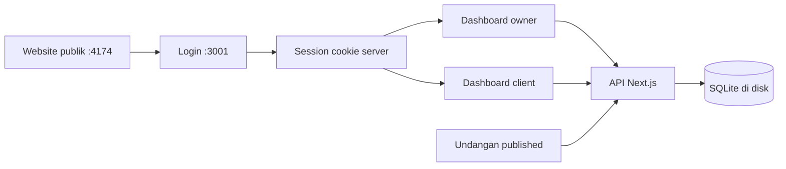

# Occasio Core

> [!summary]
> Occasio menjual layanan undangan digital per acara dengan proses produksi yang terukur. Rilis pertama Basic. Backend dijalankan sendiri memakai Next.js dan SQLite.

Baca file ini pada setiap sesi pekerjaan, lalu dokumen terkait. Folder `docs` dapat dibuka sebagai Obsidian vault. Catatan historis tidak mengalahkan keputusan aktif di sini.

## Keputusan aktif pemilik

- 6 November 2026: model layanan per event, Basic untuk pilot pertama; Premium/Signature ditunda.
- 8 November 2026: website publik dan aplikasi admin terpisah; pengujian localhost dahulu.
- 8 November 2026: contoh Sheila & Yoga menjadi materi demo; sasaran konten dapat diedit melalui admin dan dipakai pada semua tema.
- 8 November 2026: **Supabase dihentikan**. Library, adapter, schema/migration, dan script setup lama dihapus dari aplikasi. Gunakan API Next.js + SQLite bawaan Node.js 24.
- Hosting belum dipilih. Pemilik mengutamakan biaya awal rendah, kemudian upgrade. VPS atau mini server dipilih setelah alur lokal selesai.
- Laptop kantor: tidak mengubah OS/firewall/security, tidak memasang software sistem, dan server hanya localhost.

## Peta sistem aktif

| Bagian | Alamat / sumber | Status |
| --- | --- | --- |
| Website publik | `127.0.0.1:4174`, root HTML | Statis; Basic dapat dikonsultasikan, harga internal tidak ditampilkan |
| Login | `127.0.0.1:3001/login` | Password diverifikasi server; tidak memakai API key |
| Owner | `/owner/dashboard`, `/owner/events/[id]` | Event dan konten membaca API lokal yang sama |
| Client | `/client/dashboard` | Akses dibatasi ke event milik akun |
| Undangan | `/wedding/sheila-yoga` | Membaca database; hanya published dan belum expired untuk publik |
| Database | `wedding-platform/data/occasio.sqlite` | Dibuat pertama kali; tidak masuk Git |

## Setup dan batas operasional

Instruksi lengkap, akun contoh development, test, backup, dan persiapan server: [BACKEND.md](BACKEND.md).

- Node.js major 24, minimum 24.17.0; tidak menambah driver database dari npm.
- Jalankan `pnpm.cmd dev` dari `wedding-platform`.
- Session HttpOnly disimpan delapan jam dan dicabut ketika logout.
- Password memakai scrypt dengan salt; token session disimpan sebagai hash.
- Akun contoh development hanya dibuat pada database baru di mode development.
- Production baru memerlukan akun owner melalui environment dan database terpisah dari development.
- Data lama di localStorage/cloud tidak dipindahkan otomatis. Tidak ada cloud yang diakses atau dihapus.
- SQLite memakai disk lokal persisten pada satu server. Skala beberapa replika memerlukan keputusan database berikutnya.

## Alur produk sasaran

```mermaid
flowchart LR
    A[Lead] --> B[Penawaran]
    B --> C[DP diverifikasi]
    C --> D[Order dan workspace]
    D --> E[Materi lengkap]
    E --> F[Produksi]
    F --> G[Review internal]
    G --> H[Approval klien]
    H --> I[Pelunasan]
    I --> J[Publish]
    J --> K[Distribusi dan RSVP]
    K --> L[Laporan dan expiry]
```

Lead, pembayaran, order, versi konten, dan publikasi mempunyai status sendiri. Perubahan konten, approval, dan publish perlu audit trail; klik tombol saja belum menjadi bukti pembayaran atau persetujuan bisnis.

## Yang sudah terhubung ke backend lokal

- Login/logout owner dan client, session server dan proteksi route/API.
- Katalog paket/template, event, konten, tamu, RSVP demo, ucapan.
- Monitoring, detail event, dan undangan memakai sumber data yang sama.
- Pembuatan akun klien oleh owner menyimpan hash password.
- Event baru berstatus draft; data tidak hilang setelah refresh.
- Owner dapat mengedit semua isi undangan, data event (nama, tanggal, venue, template, paket, klien, masa berlaku, slug, status), tamu, dan menghapus ucapan. Halaman `/owner/manage` mengelola paket, template, dan akun (reset password, ganti password sendiri).
- Website publik (port 4174) memuat paket, template aktif, FAQ, testimoni, nomor WhatsApp, dan tampilan harga dari `GET /api/public-site` (CORS sama seperti leads); diatur di tab "Situs publik" pada `/owner/manage`. Bila server mati, isi bawaan `assets/js/config.js` dan `data/templates.js` dipakai. Tabel perbandingan paket di `index.html` masih statis.
- Media: owner mengunggah foto, video, dan musik (`POST /api/upload`, dilayani `GET /api/media/...` dengan dukungan Range), mengurutkan, dan menghapus dari detail event. Keempat tema membaca media lewat `lib/themes/media.ts`; bagian tanpa media disembunyikan dan tidak ada lagi foto bawaan Sheila & Yoga (event contoh diberi media sendiri satu kali di database dev).
- Alur bisnis tersimpan di server (`lib/backend/business.mjs`): order dan tagihan (DP 50% + pelunasan, snapshot harga paket, dibuat otomatis saat event dibuat), laporan pembayaran klien lalu verifikasi owner; versi konten dengan hash isi + persetujuan klien atas versi tertentu (isi berubah setelah disetujui = persetujuan gugur); gerbang publish di server (wajib disetujui klien dan lunas, owner dapat mengecualikan dengan alasan yang tercatat); masa berlaku otomatis dari durasi paket saat publish; chat per event; riwayat audit; ringkasan pipeline, tugas, dan pendapatan di dashboard owner dihitung dari data nyata. Draft hanya dapat dipratinjau owner dan klien pemilik.
- Tamu publik tidak menerima daftar tamu; draft/expired ditolak server.
- Lead/konsultasi: form website publik (`POST /api/leads`, CORS hanya untuk `OCCASIO_PUBLIC_ORIGINS`, default `127.0.0.1:4174`/`localhost:4174`) dan `/consultation` tersimpan di SQLite. Inbox di dashboard owner: status, catatan, hapus, ringkasan template/budget/paket. Tombol "Jadikan klien" membuat akun klien (password sementara tampil sekali) dan event draft Basic dalam satu transaksi. Ada kolom jebakan bot dan batas 5 kiriman per 10 menit.

## Yang belum selesai

- Pembayaran masih manual: owner memverifikasi transfer secara manual; belum ada payment gateway. Notifikasi (email/WhatsApp) belum ada; chat memakai polling 5 detik.
- Klien belum dapat mengedit konten sendiri selain salam pembuka; revisi dikerjakan owner lalu diajukan sebagai versi baru.
- `intro.mp4` contoh berukuran 31 MB dan belum dikompres (tidak ada ffmpeg di mesin ini); dimuat hanya metadata sampai diputar.
- RSVP lewat link pribadi bertoken (`?g=`), idempoten dan dibatasi pax; kuota tamu per paket, ekspor CSV, `customCss` dibatasi, backup/restore tersedia (Fase 5). Belum: moderasi ucapan otomatis, halaman khusus "undangan berakhir" untuk tamu (server mengembalikan 403 sehingga tampil "tidak ditemukan"), uji perangkat fisik.
- Semua tema Sheila & Yoga dan katalog publik belum direkonsiliasi.
- Restore backup, pengujian beban, SOP, dan production deployment belum diluluskan.

## Bukti verifikasi — 8 November 2026

- Browser: owner berhasil login ke dashboard, logout kembali ke login, lalu client berhasil masuk ke dashboard miliknya.
- Lima test backend lulus: persistensi setelah database dibuka ulang, password/session, throttling, isolasi client, dan pembatasan edit.
- HTTP smoke test lulus: login/password salah, Origin ditolak, daftar tamu privat, larangan client mempublish/membuat akun, simpan/baca konten lintas akun, logout, dan redirect route terlindungi. Perubahan greeting uji dikembalikan ke nilai semula.
- TypeScript dan build production Webpack lulus. Lint: 0 error, 9 warning optimasi gambar yang sudah ada.
- Tidak ada dependency/import/config Supabase di runtime aplikasi. File database dan session lokal diabaikan Git; tidak ada cloud yang dimodifikasi.

## Audit tampilan responsif — 8 November 2026

- Pertahankan identitas warna cream/cokelat dan tipografi workspace; tema undangan tetap mempunyai karakter masing-masing.
- Gutter workspace 16–32px, jarak antarkelompok 16–24px, kontrol utama minimal 44px, dan field HP 16px agar tidak memicu zoom saat fokus.
- Header dashboard tidak menutupi konten saat scroll di HP/tablet; judul membungkus, statistik dua kolom, grid tablet tidak terlalu rapat.
- Wizard memakai label langkah sejajar; filter template membungkus, pilihan template dapat diakses keyboard, thumbnail hilang memakai ilustrasi fallback.
- Dialog admin/klien memakai satu komponen native dengan scroll internal, fokus keyboard, Escape, dan pengembalian fokus. Tabel lebar digeser di dalam area tabel, bukan seluruh halaman.
- Website publik: perbaikan lebar HP kecil, navigasi tertutup tidak menerima fokus, safe area tombol bawah, dan ukuran/jarak modal.
- Tema Classic Elegant, Cinema Story, Playlist Romance, dan Travel Ticket diperiksa di HP/tablet; judul, kartu, grid, countdown, dan form dirapikan tanpa menyamakan gaya temanya.
- Browser responsive: 320px, 390px, 768px, 1024px, 1440px. Website publik/galeri, login, owner, client, wizard, detail event, chat, check-in, dan undangan diperiksa; tidak ada overflow horizontal halaman pada skenario yang diuji. Scroll tabel/navigasi yang disengaja tetap tersedia.
- Dialog export dan bagikan diuji pada 320px: muat dalam layar, Escape menutup, fokus kembali ke pemicu. Template contoh yang diganti sementara untuk audit telah dikembalikan ke Classic Elegant.
- Pengujian ini memakai emulasi viewport browser; perangkat fisik dan keyboard layar HP belum diuji.
- Setelah perubahan UI: TypeScript, build production Webpack, syntax navigasi JavaScript, dan diff check lulus; lint 0 error dengan 9 warning gambar lama. Tidak ada dependency baru.
- Koreksi aset demo: foto lama `/demo/sheila.jpg` dan `/demo/yoga.jpg` menunjuk file yang tidak ada. Seed kini memakai foto di `public/templates/sheila-yoga/assets/images`; API memetakan dua referensi lama dan thumbnail demo lama tanpa mereset database atau mengubah URL foto kustom. Kedua foto diverifikasi tampil di browser dan merespons HTTP 200. Tes regresi: `node --test tests/assets.test.mjs`.

## Paket dan CFM bisnis

| Paket | Baseline internal | Scope | Status |
| --- | --- | --- | --- |
| Basic | Rp799.000 | 150 rekaman undangan, 10 foto, 2 revisi, 3 bulan | Pilot pertama setelah alur inti lulus |
| Premium | Rp1.490.000 | 500 rekaman, 30 foto, 3 revisi, 6 bulan; QR digital tanpa kru/perangkat | Ditunda |
| Signature | Rp2.990.000 | 1.000 rekaman, 50 foto, 5 revisi, 12 bulan; scope venue harus dihitung | Ditunda |

DP 50%, pelunasan sebelum publish. Harga masih hipotesis internal; hitung jam kerja, support, revisi, infrastruktur, dan margin sebelum menetapkan harga jual.
Satu rekaman undangan berbeda dari pax hadir. Tidak menjanjikan unlimited atau pengiriman WhatsApp otomatis.

Belum disahkan rinci: jam dukungan, masa berlaku penawaran, refund, reschedule, retensi data, serta biaya/kapasitas venue.
White-label/SaaS vendor ditunda sampai layanan per acara terbukti.

## Prioritas berikutnya

1. Tuntaskan upload media dan preview Sheila & Yoga untuk setiap tema.
2. Persistenkan lead/chat dan order/invoice dengan pembayaran manual terverifikasi.
3. Implementasikan versi konten, approval klien, dan gerbang publish server.
4. (Selesai) Token tamu, RSVP idempotent, kuota, ekspor; expiry ditegakkan server.
5. Uji dua klien, dua browser, kondisi gagal, backup/restore, lalu pilot demo.
6. Pilih hosting, siapkan HTTPS dan rollback, minta izin sebelum deployment.

## Definition of done sebelum data nyata

- Client A tidak dapat mengakses data privat Client B.
- Draft dan event expired tidak terbuka ke publik.
- Gagal menyimpan tidak menghasilkan sukses palsu.
- Media dan konten tersedia lintas perangkat.
- Publish memerlukan versi disetujui dan pelunasan.
- RSVP/retry tidak menggandakan hitungan dan tidak melampaui pax.
- Owner dapat menjalankan satu order memakai SOP.
- Backup database/media dapat dipulihkan.

## Navigasi vault

- [[business-model-occasio|Detail baseline bisnis]]
- [[roadmap-production|Roadmap produk; bagian backend lama sudah digantikan]]
- [[audit-aplikasi-g1|Audit UX historis]]
- [Runbook backend aktif](BACKEND.md)

Catatan fondasi G2 lama telah dihapus karena setup providernya tidak digunakan. Riwayatnya tetap tersedia di Git.

